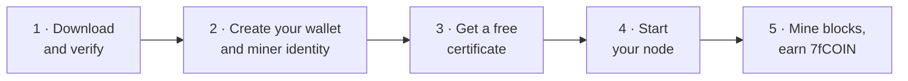
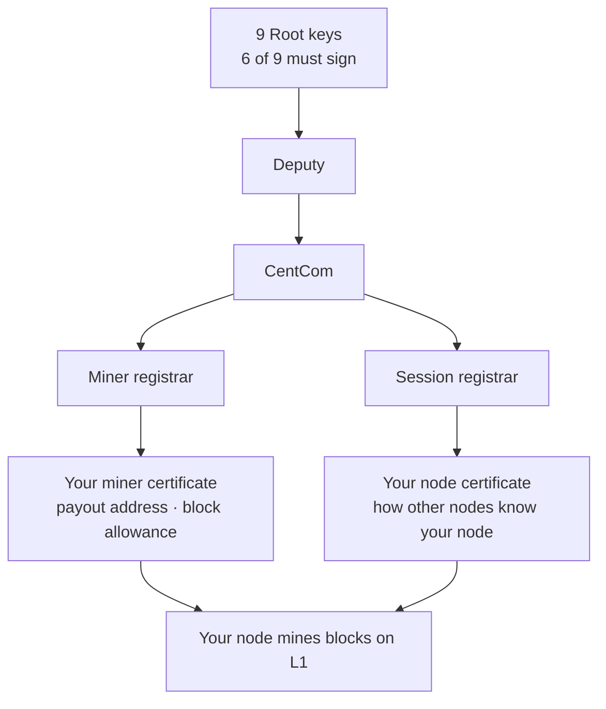

# 7fchain

**The Post-Quantum Blockchain for the People.**

7fchain is a proof-of-work blockchain that is quantum-resistant from its first block. It's built to be mined by ordinary people on ordinary computers — an old laptop or a $20/month server, not ASIC farms or data centers. Layer 1 is a lean post-quantum settlement layer; the 7F L2 Lattice on top is where fast, cheap, stable everyday payments live.

[**Download**](https://github.com/Seven-Fortunas/7fchain/releases/latest) · [**Become a miner**](docs/become-a-miner.md) · [**Explorer**](https://explore.sevenfortunas.com/) · [**Papers**](papers/) · [**Discussions**](https://github.com/Seven-Fortunas/7fchain/discussions)

## Start here

| I want to… | Go to |
|---|---|
| Start mining | [Become a miner](docs/become-a-miner.md): five steps on an ordinary computer |
| Install a new release over my node | [Update your miner](docs/update-your-miner.md) |
| Fix an error message | [Troubleshooting and FAQ](docs/troubleshooting.md) |
| Look up a command, file or setting | [Reference](docs/reference.md) |
| See my rewards | [Your mining rewards](docs/rewards.md) |
| Understand why 7fchain exists | [Mission & Design](papers/7fchain-mission-and-design.md) |
| Read the technical design | [L1 White Paper](papers/7fchain-l1-white-paper.md) |

## Mine in five steps

1. [Verify your download](docs/verify-your-download.md), then run `./setup.sh`.
2. [Create your wallet and miner identity](docs/create-wallet-and-request.md).
3. [Get a testnet certificate](docs/get-a-testnet-certificate.md) with `sf-node obtain`.
4. [Run your node](docs/run-your-node.md).
5. Watch your blocks on the [explorer](https://explore.sevenfortunas.com/miners), and [keep your node running](docs/keep-running.md).

The full walkthrough is [Become a miner](docs/become-a-miner.md). Builds are published for `x86_64-linux`, `aarch64-linux`, `arm64-macos` and `x86_64-macos`; on Windows, use [WSL](docs/install-wsl.md). Mac users, see [7fchain on macOS](docs/macos.md).

## How it fits together

Every miner holds a post-quantum certificate that traces back to nine Root keys, six of which must sign before anything at the top of the chain can exist. Your miner certificate carries your payout address and a block allowance.

Layer 2 chains settle on Layer 1 and carry the fast, cheap, stable payments. Two ways to take part:

- **Run a miner.** Help secure the network and earn 7fCOIN. CPU-mineable, certificate-gated, with a cooldown that keeps rewards spread across the community. → [Become a miner](docs/become-a-miner.md)
- **Build on Layer 2.** Seven Fortunas operates Layer 2 networks for enterprises and governments, and partners can run their own.

## Already mining? The testnet restarted from block 1

With release `testnet-2026-10-16.2` the testnet started again from block 1, and
certificates from earlier releases no longer work. If you mined before, three
things to do, step by step in **[Update your miner](docs/update-your-miner.md)**:

1. Run `./setup.sh --clean` from the new release. Plain `./setup.sh` would keep
   the old chain database, and the node would not join the new chain.
2. Move your old certificates out of `miner-0/`.
3. Get new ones with `sf-node obtain`. Your API key's allowance has been reset.

Your wallet and keys are kept. New miners can ignore this and follow
[Become a miner](docs/become-a-miner.md).

## Papers

- [Mission & Design](papers/7fchain-mission-and-design.md) — why 7fchain exists *(start here)*
- [Executive Summary](papers/7fchain-executive-summary.md) — the whole project in a few pages
- [L1 White Paper](papers/7fchain-l1-white-paper.md) — the technical design
- [Tokenomics](papers/7fcoin-tokenomics.md) — 7fCOIN supply, rewards, and 7fUSD
- [Constitution](papers/7fchain-constitution.md) — the ethos and the rules we hold ourselves to

*Each paper is provided as Markdown, readable here on GitHub and by AI agents, in [`papers/`](papers/). All the miner guides are listed in [`docs/`](docs/).*

## Get help

- **Something not working?** [Troubleshooting and FAQ](docs/troubleshooting.md) covers the messages you're likely to see, and the [Reference](docs/reference.md) lists every command, file and setting.
- **Questions, ideas and show-and-tell:** [GitHub Discussions](https://github.com/Seven-Fortunas/7fchain/discussions). Start with [Q&A](https://github.com/Seven-Fortunas/7fchain/discussions/categories/q-a).
- **Found a security problem?** Don't open a public issue. Report it privately as described in [SECURITY.md](SECURITY.md), or email security@sevenfortunas.com.
- **Anything else:** build@sevenfortunas.com

## Status

7fchain is on **testnet**, which runs the same software and protocol values as mainnet; mainnet differs only in its own set of nine Root key holders. Mainnet launches once the network is producing blocks from 70 distinct, geographically distributed miners — our goal is December 2026, but the condition comes first: the date doesn't override the threshold. **No meme coins. No spam. No scams. Only utility.**

## Free to use

The 7fchain binaries are free to download, run, and share — no license fee, no restrictions. On testnet, miner certificates are free and issued by invitation (see [Become a miner](docs/become-a-miner.md)). Mainnet certificates are issued under a published policy. The white papers and documentation here are free to read and redistribute.
