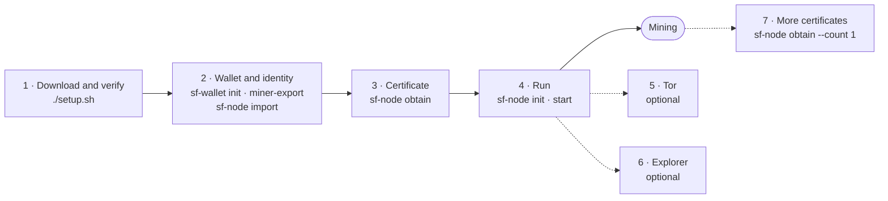

# Become a 7fchain Testnet Miner

7fchain is live on **testnet** — this is how you join it. Testnet runs the same software and protocol values as mainnet; mainnet differs only in its own set of nine Root key holders. You run a real miner and earn testnet 7fCOIN, which has no monetary value. It runs on an ordinary computer — no GPU, no special hardware.

**Already mining?** To install a new release over your existing node, follow [Update your miner](update-your-miner.md).

**You'll need Linux:** Ubuntu 22.04, Debian 12 or newer, on x86_64 or ARM. The current release is built for Linux; Macs are covered in [7fchain on macOS](macos.md). On Windows, use Ubuntu via **Windows Subsystem for Linux (WSL)** ([install guide](install-wsl.md)).

> **Testnet vs. mainnet.** On testnet it's fine to run everything on your normal machine — nothing of value is at stake, so it's the place to practice. **For mainnet you'll want your keys on an air-gapped machine** — see [Securing your keys for mainnet](securing-your-keys.md).

## 1. Download and verify

Download the build from the [latest Release](https://github.com/Seven-Fortunas/7fchain/releases/latest) and check it against the published `SHA256SUMS` before running. The bundle includes the `sf-node`/`sf-wallet`/`sf-explorer` programs plus the public network files (the genesis and dev-fund configs and the network's Root, Deputy and CentCom certificates) and `THIRD-PARTY-NOTICES.txt`, which lists the open-source components in the programs and their licenses; the trusted root keys are built into the node. (Your certificate and the chain that validates it arrive later, in step 3.) Unpack it (`tar xzf`, as in [Verify your download](verify-your-download.md#then-continue)) and run `./setup.sh` once — it installs the programs and lays out your node folders.
→ **Step-by-step:** [Verify your download](verify-your-download.md)

## 2. Create your wallet and miner identity

Run `sf-wallet` to create your wallet (save your recovery phrase somewhere safe) and your miner identity, then hand the identity to your node with `sf-node import`. Your keys are made on your own machine and never sent anywhere.
→ **Step-by-step:** [Create your wallet & miner identity](create-wallet-and-request.md)

## 3. Get your testnet certificate (free)

A certificate is what lets your node join and mine. **On testnet it's free.** One command, `sf-node obtain`, asks the registrar for your certificate and installs it, along with the registrar's own certificate — nothing to upload or copy. While the testnet is young, certificates are **by invitation**: you'll need the API key you were sent.
→ **Step-by-step:** [Get a testnet certificate](get-a-testnet-certificate.md)

## 4. Run your node

Create your node's config and start it — it joins the network, catches up to the current tip, and begins mining. Blocks you win pay your reward address.
→ **Step-by-step:** [Run your node](run-your-node.md)

## 5. Make your node reachable (optional)

An ordinary home connection gives your node no way to accept incoming connections, so it can reach other nodes but none can reach it. Publishing a Tor onion address fixes that in a few minutes, with no port forwarding and no static IP. Skip this step if you like — your node syncs, mines, and gets paid either way.
→ **Step-by-step:** [Make your node reachable over Tor](tor-for-your-node.md)

## 6. Watch the chain (optional)

Run a local block explorer to see blocks, transactions, and your node's progress in your browser. The network's public explorer is at [explore.sevenfortunas.com](https://explore.sevenfortunas.com/).
→ **Step-by-step:** [Run your own explorer](run-an-explorer.md)

## 7. Get more certificates when yours run out

Each certificate mines a limited number of blocks. When yours is used up, get another with `sf-node obtain --count 1`. It lands beside the old one and your node picks it up on its own, with no restart.
→ **Step-by-step:** [When your certificates run out](get-a-testnet-certificate.md#when-your-certificates-run-out). To mine under a second identity instead, see [Rotate to a new certificate](rotate-your-certificate.md).

## Good to know

- **Rewards.** How your rewards arrive, and when you can spend them: [Your mining rewards](rewards.md).
- **Keep it running.** Run the node so it survives closing the terminal: [Keep your node running](keep-running.md). On a Mac, see also [7fchain on macOS](macos.md).
- **It's testnet.** Testnet 7fCOIN has no monetary value, so it's the place to practice.
- **Your coins are yours.** Your spending keys are separate from your node's identity, so even if a certificate is revoked, coins already paid to your address stay yours.
- **Per-cert block cap.** Each certificate mines a limited number of blocks over its life; when it's used up, your node moves to the next one it holds. [Get more](get-a-testnet-certificate.md#when-your-certificates-run-out) in advance, while the node runs, so there's no downtime.
- **Cooldown.** After you mine a block, your certificate waits a while before it can mine again — spreading rewards across the community so small miners get a fair share.

## Feedback

Stuck, confused, or have an idea? Tell us in our [short feedback form](https://forms.gle/acBoEKEMBeh6piE67) — it takes a minute, and you can stay anonymous. Please don't include your API key, recovery phrase, passwords, or key files.

Found a security issue? Please don't post it anywhere public. [Report it privately on GitHub](https://github.com/Seven-Fortunas/7fchain/security/advisories/new) (needs a GitHub account), or use the feedback form above.

For the full design, see the [L1 White Paper](../papers/7fchain-l1-white-paper.md).
