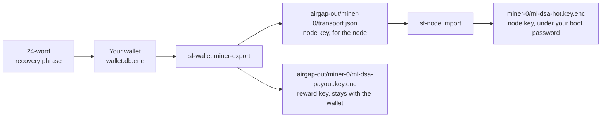

# Create Your Wallet and Miner Identity

This is **step 2** of [Become a miner](become-a-miner.md). It assumes you've already downloaded, verified, and run `./setup.sh` — so the programs are installed and your node home exists at `~/7fchain/testnet/l1/`.

You'll set up a few secrets along the way — keep them straight:

| Secret | What it's for |
|---|---|
| **24-word recovery phrase** | Restores *every* key in your wallet. |
| **Wallet passphrase** | Encrypts the wallet file on disk; you enter it to open the wallet. |
| **Transport password** | Protects your node's key on its way from the wallet to the node. You need it only until `sf-node import` succeeds (see step 4). |
| **Boot password** | You set it when you import, and enter it every time you start the node. |
| **Mining-key password** *(recommended)* | Encrypts the key that spends your mining rewards. |

> **Testnet vs. mainnet — where you run this matters.** On **testnet**, run everything on one ordinary machine and write your recovery phrase on paper — that's the point of practicing. On **mainnet**, run `sf-wallet init` and `sf-wallet miner-export` on an **air-gapped (never-online) machine**. Then carry only `transport.json` (your node key, encrypted) to your online "hot" node, while your **recovery phrase and your reward key never leave the air-gapped machine.** Full procedure: [Securing your keys for mainnet](securing-your-keys.md).

> *(If a command says "not found": on Linux or WSL, open a new terminal — `setup.sh` adds the programs to your `PATH`, which a fresh shell picks up. On macOS, run `echo 'export PATH="$HOME/.local/bin:$PATH"' >> ~/.zshrc` once, then open a new terminal.)*

How the keys fit together:



## 1. Go to your node home

```
cd ~/7fchain/testnet/l1
```

Run the next commands from here, so your wallet file is stored alongside the rest of your node.

## 2. Create your wallet

```
sf-wallet init
```

- It walks you through building a **24-word recovery phrase**, asking you to choose between word sets and to place a few words yourself. Your choices are part of the phrase, so it is not something the software decided on its own.
- **Don't write anything down during the building steps** — not the word sets in step 1, nor the candidates after. When it finishes, it shows the complete phrase under **"WRITE THESE 24 WORDS ON PAPER NOW"**: that is the one to write down.
- **Write the finished phrase on paper.** It controls all your keys; never put it in cloud storage, a screenshot, or a password manager.
- Already have a phrase? `sf-wallet init --import` accepts an existing 12- or 24-word BIP-39 phrase instead.
- It asks you to set a **wallet passphrase** (separate from the recovery phrase) and type it twice. Write that down too. **Have it ready before you start:** it can't be empty, and if it's empty or the two entries don't match, `sf-wallet init` stops without creating the wallet. Running it again builds a *new* phrase, so cross out the words you wrote and write the new ones.
- It prints your testnet address (starts with `t1…`).

## 3. Create your miner identity

```
sf-wallet miner-export
```

Enter your **wallet passphrase** to open the wallet, then use the menu **in this order**:

- **3** — Set the transport password *(required)*
- **4** — Set the mining-key password *(encrypts your reward key; don't skip it)*
- **7** — Write the identity

*(Menu options 1, 2 and 5 are help text. Option 6 skips the mining-key password and saves your reward key unencrypted; the program itself warns against it on testnet.)*

It prints your **payout address** (starts with `t1…`) — the address your mining rewards are paid to — and writes two files to `~/7fchain/testnet/l1/airgap-out/miner-0/`:

- `transport.json` — your node's signing key, encrypted with the transport password.
- `ml-dsa-payout.key.enc` — the key that **spends** your rewards. On testnet you can leave it here; **on mainnet it stays on the air-gapped machine** (see the callout above).

## 4. Give the identity to your node

```
sf-node import airgap-out/miner-0/transport.json
```

It asks for the **transport password** from step 3, then asks you to set this node's **boot password** — the one you'll type every time the node starts. It prints a **key fingerprint** and your payout address: both should match what `sf-wallet miner-export` showed. If they don't, stop and check you imported the right file.

**Confirm it worked:**

```
ls miner-0/ imported/miner-0/
```

You should see `ml-dsa-hot.key.enc` (your node's key) and `payout.json` (your payout address).

**You're done with the transport password.** From now on your node's key is protected by the boot password. The transport password still opens `airgap-out/miner-0/transport.json`, though, so once the import has worked, delete that file:

```
rm airgap-out/miner-0/transport.json
```

You don't need to keep it, or the transport password: if you ever need to import the same identity again (for example on a new machine), run `sf-wallet miner-export --force` to make a fresh `transport.json` with a new transport password. It contains the same key, because it's derived from your recovery phrase.

## Next

Get your **free testnet certificate** → [Get a testnet certificate](get-a-testnet-certificate.md).
