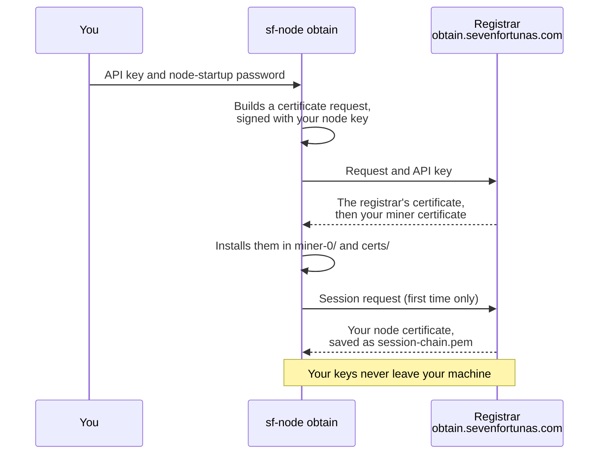

# Get a Testnet Certificate (free)

This is **step 3** of [Become a miner](become-a-miner.md). It assumes you've created your wallet and given your node its identity ([step 2](create-wallet-and-request.md)), so `~/7fchain/testnet/l1/miner-0/` holds your node's key.

A certificate is what lets your node join the network and mine. **Testnet certificates are free.** Your node asks for one itself, with a single command, and installs what comes back — there is no file to upload and nothing to copy.



## What you need

- **An API key** — a 16-character code. While the testnet is young, keys are **by invitation**: if you've been invited, you'll have received one.
- An internet connection on the machine that runs your node.

Treat the key like a password: don't post it, and don't type it straight onto the command line, where it would be saved in your shell history.

## 1. Go to your node home

```
cd ~/7fchain/testnet/l1
```

## 2. Load your API key

```
printf 'API key: '; read -rs SF_OBTAIN_KEY; echo; export SF_OBTAIN_KEY
```

Paste your key and press Enter — nothing is shown as you type. This sets it for the current terminal only.

Check that it went in, without showing it:

```
[[ $SF_OBTAIN_KEY =~ ^[0-9a-fA-F]{16}$ ]] && echo "API key loaded." || echo "That's not a 16-character key — run the line above again."
```

This only checks the key's shape; the registrar checks the key itself in step 3.

## 3. Get your certificate

```
sf-node obtain --count 1
```

Enter your **node-startup password** when asked. The node builds its certificate request from your key, sends it to the network's registrar, checks that what comes back belongs to the testnet, and installs it. You should see lines like:

```
network: testnet  (home /home/you/7fchain/testnet/l1)
GET https://obtain.sevenfortunas.com/obtain-chain/miner-cert
POST https://obtain.sevenfortunas.com/cert/sign/miner-cert  (1 request(s))
installed miner-0/ ...
filed /home/you/7fchain/testnet/l1/certs/registrar-...pem
wrote session chain /home/you/7fchain/testnet/l1/session-chain.pem
```

That installs your **miner certificate** in `miner-0/`, the **registrar's certificate** that signed it in `certs/` (the `filed` line, the first time only), and a **session certificate** your node shows to its peers. Your request carries your payout address, so the certificate pays your rewards to you.

When you're done, close the terminal, or run `unset SF_OBTAIN_KEY`.

## When your certificates run out

**Each testnet certificate currently lets your node mine 50 blocks** (and is valid for several months; `sf-node certs` shows both). When a certificate has mined its 50, your node moves to the next one it holds. When it has none left, it stops mining — it keeps running and syncing, but earns nothing until you get more.

**See how many blocks you have left.** Stop your node, then run, from your node home:

```
sf-node certs
```

```
  index serial              blocks left  valid until            status
  0     01000000000079         41 of 50  2027-05-18 23:09Z      usable
```

While the node is running it shows `?` instead of the counts, because the running node has the chain data open. Start the node again afterwards.

**Get more.** Load your API key as in [step 2](#2-load-your-api-key), then, from your node home:

```
sf-node obtain --count 1
```

`--count` is how many certificates to get, at 50 blocks each: `--count 5` gets five. Each one uses one certificate from your API key's allowance, so ask only for what you'll use. You can run this while your node is running: new certificates land in `miner-0/` beside the others, and the node picks them up when it needs the next one — no restart.

## Trouble?

- **`pass --key <api-key> or set SF_OBTAIN_KEY`** — the key isn't loaded in this terminal. Repeat step 2 in the same terminal you run step 3 from.
- **"HTTP 401 … unknown API key"** — the key was mistyped. Repeat step 2 and paste it again.
- **"quota"** — your key has used its certificate allowance. Ask the person who invited you.
- **"no miner identity … Import one first"** — step 2 isn't finished: run `sf-node import airgap-out/miner-0/transport.json` from your node home.
- **"Failed to decrypt"** — wrong node-startup password. It's the one you set during `sf-node import`.
- **"refusing to install: … a different certificate for the same key"** — the registrar returned a certificate that conflicts with one your node already holds. Nothing was installed. Report it, with the full message, through the feedback form in [Become a miner](become-a-miner.md).

## Next

→ **[Run your node](run-your-node.md)**
