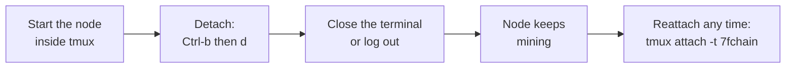

# Keep Your Node Running

Your node mines only while it runs. `sf-node start` runs in the terminal you start it from, so closing that terminal, logging out, or letting the computer sleep stops it. This page shows how to keep it going.



## 1. Run it in tmux

`tmux` keeps a terminal session alive after you close the window or disconnect from a server.

Install it once. On Debian, Ubuntu or WSL:

```
sudo apt install tmux
```

On macOS, with [Homebrew](https://brew.sh):

```
brew install tmux
```

Start a session named `7fchain` and start your node in it:

```
tmux new -s 7fchain
sf-node start
```

Enter your boot password as usual. Once it's running, press **`Ctrl-b`, then `d`** to detach. The node keeps running; you can close the terminal or log out.

To look at it again:

```
tmux attach -t 7fchain
```

To stop it, attach and press `Ctrl-C`, or run `sf-node stop` from any terminal.

## 2. Keep the computer awake

A computer that sleeps stops mining until it wakes.

- **macOS:** start the node with `caffeinate` in front, and the Mac stays awake while it runs: `caffeinate -i sf-node start`. A MacBook still sleeps when you close the lid, unless it's connected to power and an external display.
- **Linux desktop or laptop:** in your power settings, turn off automatic suspend. On a laptop, also set what happens when the lid closes.
- **Linux server or rented server:** servers don't sleep; nothing to do.
- **Windows with WSL:** keep the Ubuntu window open, and in Windows Settings set **Sleep** to **Never** while you mine. Windows pauses WSL when it sleeps.

## 3. After a restart

When the computer restarts, start the node again the same way: `tmux new -s 7fchain`, then `sf-node start`, and enter your password. The node picks up where it left off from the chain on disk, without downloading it again.

## 4. Keep a log

To keep a copy of the node's output in a file as well as on screen:

```
sf-node start 2>&1 | tee -ia ~/7fchain/testnet/l1/node.log
```

Keep the `-i`: it lets `Ctrl-C` reach the node for a clean shutdown. `tail -f ~/7fchain/testnet/l1/node.log` follows the log from another terminal.

## Mine only at certain hours

To mine only part of the day, for example overnight, set a mining window; see `sf-node mining` in the [Reference](reference.md#sf-node-commands). The node stays connected outside the window and resumes mining when it opens. Restart the node after changing the schedule: it reads the schedule when it starts.

---

Back to [Docs](README.md) · [Run your node](run-your-node.md) · [Troubleshooting and FAQ](troubleshooting.md)
