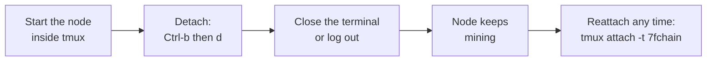

# Keep Your Node Running

Your node mines only while it runs. `sf-node start` runs in the terminal you start it from, so closing that terminal, logging out, or letting the computer sleep stops it. This page shows how to keep it going.



## 1. Run it in tmux

`tmux` keeps a terminal session alive after you close the window or disconnect from a server.

Install it once. On Debian, Ubuntu or WSL:

```
sudo apt install tmux
```

On macOS, with [Homebrew](https://brew.sh):

```
brew install tmux
```

Start a session named `7fchain` and start your node in it:

```
tmux new -s 7fchain
sf-node start
```

Enter your boot password as usual. Once it's running, press **`Ctrl-b`, then `d`** to detach. The node keeps running; you can close the terminal or log out.

To look at it again:

```
tmux attach -t 7fchain
```

To stop it, attach and press `Ctrl-C`, or run `sf-node stop` from any terminal.

## 2. Keep the computer awake

A computer that sleeps stops mining until it wakes.

- **macOS:** start the node with `caffeinate` in front, and the Mac stays awake while it runs: `caffeinate -i sf-node start`. A MacBook still sleeps when you close the lid, unless it's connected to power and an external display.
- **Linux desktop or laptop:** in your power settings, turn off automatic suspend. On a laptop, also set what happens when the lid closes.
- **Linux server or rented server:** servers don't sleep; nothing to do.
- **Windows with WSL:** keep the Ubuntu window open, and in Windows Settings set **Sleep** to **Never** while you mine. Windows pauses WSL when it sleeps.

## 3. After a restart

When the computer restarts, start the node again the same way: `tmux new -s 7fchain`, then `sf-node start`, and enter your boot password. The node picks up where it left off from the chain on disk, without downloading it again.

## 4. Keep a log

To keep a copy of the node's output in a file as well as on screen:

```
sf-node start 2>&1 | tee -ia ~/7fchain/testnet/l1/node.log
```

Keep the `-i`: it lets `Ctrl-C` reach the node for a clean shutdown. `tail -f ~/7fchain/testnet/l1/node.log` follows the log from another terminal.

## 5. Resync the chain

If the node stops with a `[chain] FATAL:` line and stops the same way again after one restart, the chain stored on your disk is damaged. This often follows a full disk. A resync moves your copy of the chain aside and downloads it again from the network.

Your wallet, keys, certificates and settings stay. Your coins, and how many blocks each certificate has mined, are recorded on the chain, so they come back with it.

1. Check that you have free disk space: `df -h ~`. If the disk filled up, free some space first, or the problem comes back.
2. If the node is still running, stop it: `sf-node stop`.
3. Move the chain files aside. Moving them, rather than deleting them, means you can put them back:

   ```
   mkdir -p ~/7fchain/testnet/l1/chain-archive
   mv ~/7fchain/testnet/l1/blocks.redb ~/7fchain/testnet/l1/chain-archive/
   mv ~/7fchain/testnet/l1/mempool.dat ~/7fchain/testnet/l1/chain-archive/ 2>/dev/null
   mv ~/7fchain/testnet/l1/rollback-request.json ~/7fchain/testnet/l1/chain-archive/ 2>/dev/null
   ```

4. Start the node the usual way (section 1) and enter your boot password. It syncs from the first block: the heights in its `accepted block` lines climb to the network's height. It usually takes a few minutes.
5. Check that mining resumed: look for `[miner] mining started`.

Once the node has run normally for a while, you can delete `chain-archive` to get the space back.

## Mine only at certain hours

To mine only part of the day, for example overnight, set a mining window; see `sf-node mining` in the [Reference](reference.md#sf-node-commands). The node stays connected outside the window and resumes mining when it opens. Restart the node after changing the schedule: it reads the schedule when it starts.

---

Back to [Docs](README.md) · [Run your node](run-your-node.md) · [Troubleshooting and FAQ](troubleshooting.md)
