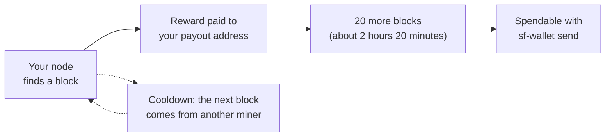

# Your Mining Rewards

How your node earns 7fCOIN, when you can spend it, and how to see and send it. Testnet 7fCOIN has no monetary value.

## How a block pays you

Every block pays a reward of 7 7fCOIN plus the fees of the transactions in it. **99% goes to your payout address** and 1% to the 7fchain development fund. Your payout address is set in your miner certificate, so the reward goes straight to your wallet: your node never holds your coins.

The reward goes down by 7% every 70,000 blocks (about 340 days) and stays at 0.07 7fCOIN once it reaches that. The full schedule is in [Tokenomics](../papers/7fcoin-tokenomics.md).

## From block to spendable



- **Spendable after 20 blocks.** A reward can be spent once the chain is 20 blocks past the block that earned it. At about 7 minutes a block, that's a little over two hours. Your balance includes it straight away. If none of your rewards are spendable yet, `sf-wallet send` tells you the height the first one becomes spendable at.
- **Cooldown.** After your certificate mines a block, the next block has to come from another miner. Your node waits, then carries on by itself. This spreads rewards across everyone mining.
- **Block allowance.** Each certificate mines a set number of blocks. When it's used up, get another with `sf-node obtain --count 1`; see [When your certificates run out](get-a-testnet-certificate.md#when-your-certificates-run-out).

## See your rewards

**On the explorer.** The [Miners page](https://explore.sevenfortunas.com/miners) lists every payout address that mined in the last 100 blocks: its blocks in that window, its share, and how many blocks are left on the certificate that mined its latest block. Searching for your address on [explore.sevenfortunas.com](https://explore.sevenfortunas.com/) shows its balance and history.

**In your wallet.** With your node running:

```
cd ~/7fchain/testnet/l1
sf-wallet balance --miner 0
```

Enter your wallet passphrase. `sf-wallet balance` with no options shows every balance in the wallet. Use `--miner 1` and so on for your other identities.

**For any address.** With your node running:

```
sf-node getaddrbalance <payout address>
```

It prints `Balance: {x} 7fCOIN ({sats} sats)`. Your payout address starts with `t1`; `sf-wallet miner-info --index 0` prints it.

**In your node's log.** Each block you win prints lines like these (each starts with the time):

```
[12:34:56.789] [miner] FOUND block 1234! nonce=…
[12:34:56.790] [miner] block 1234 stored. reward: 7 7fCOIN
[12:34:56.790] [miner] cert serial …: 3/50 blocks mined, 47 left before this identity is spent
```

The `reward:` line shows the block's new coins, before the 99/1 split. If the block carried transactions, a line `included … mempool tx(s); fees=… sats` shows its fees. Your address receives 99% of the two together.

## Send your rewards

With your node running, from `~/7fchain/testnet/l1`:

```
sf-wallet send
```

It asks for the recipient, the amount and the identity to pay from, shows the transaction with its fee, and asks you to confirm. To do it in one line instead:

```
sf-wallet send --from-miner 0 --to <address> --amount <coins>
```

Use `--max` in place of `--amount` to send everything that's spendable, and `--dry-run` to see the transaction without sending it.

Your wallet signs with the reward key it derives from your recovery phrase, so sending needs only your wallet and its passphrase. On mainnet the wallet lives on an offline machine: see [Securing your keys for mainnet](securing-your-keys.md).

## Questions

- **I mined a block but my balance didn't change.** Check that the node is running (`sf-wallet` reads balances through it), and that you're looking at the right identity (`--miner 0`, `--miner 1`, …).
- **My block shows "stored on fork".** Another miner's block for the same height reached the network first, so yours doesn't pay. Your node carries on with the next block.
- More in [Troubleshooting and FAQ](troubleshooting.md#rewards).

---

Back to [Docs](README.md) · [Reference](reference.md)
