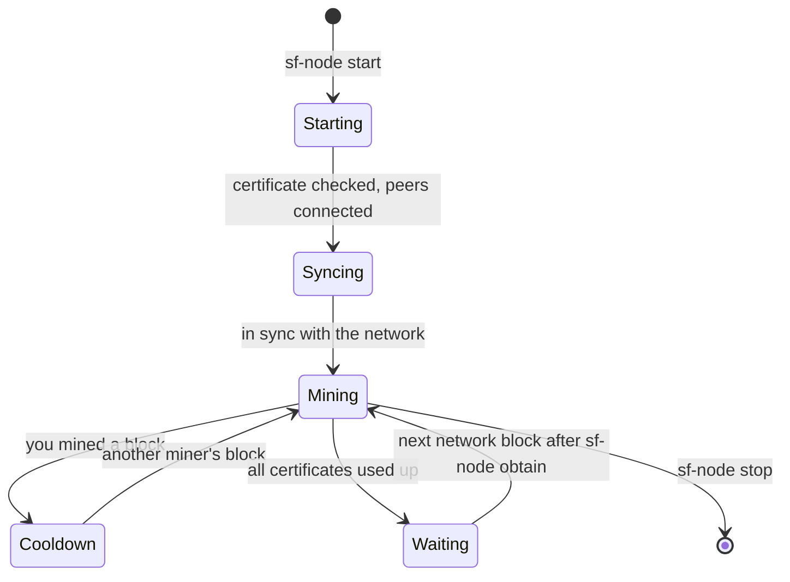

# Run Your Node

This is **step 4** of [Become a miner](become-a-miner.md). It assumes you've run `./setup.sh`, created your wallet and miner identity ([step 2](create-wallet-and-request.md)), and gotten your certificate with `sf-node obtain` ([step 3](get-a-testnet-certificate.md)).

## 1. Your certificate is already in place

When you ran `sf-node obtain`, it installed everything for you. **There is nothing for you to copy.**

- Your **miner certificate** is in `~/7fchain/testnet/l1/miner-0/`, beside your key, one file per certificate. Each file holds your certificate alone.
- The **registrar's certificate**, which signed yours, went into `certs/`. The network's own certificates are already there from `setup.sh`, along with the genesis and dev-fund files.

The node puts the two together when it starts. A file in `miner-0/` that holds a whole chain (several certificates) comes from an older release: the node refuses to start with it. See [Update your miner](update-your-miner.md).

## 2. Create your node config

```
sf-node init ~/7fchain/testnet/l1
```

This writes `node-config.json`, pointing the node at your node home, where it finds `miner-0/`, `certs/` and `session-chain.pem`; you should see `Adopted the session chain already here: …`. It then prints a list of next steps written for other setups: you've done them, so carry on below. You only do this once.

## 3. Start the node

```
sf-node start ~/7fchain/testnet/l1/node-config.json
```

At `Enter ML-DSA keyfile password:`, type your **boot password** (the one you set during `sf-node import`). At boot the node verifies your certificate chains to a trusted root, connects to the network's peers, catches up to the current tip, and **then** begins mining. It won't mine until it's synced — if peers aren't reachable yet it waits, which is normal. Blocks you win pay your payout address.

Leave it running to keep mining. Step 4 shows you how to stop it and start it back up.

## 4. Check a restart

Do this once, the first time you run a node.

**Watch it catch up.** As your node pulls the chain it prints a line for each
block it takes:

```
[dispatch] accepted block 1 from 203.0.113.10:7788
[dispatch] accepted block 2 from 203.0.113.10:7788
```

Let it get through a hundred or so. Before those you'll have seen
`[genesis] Genesis block: ...` and `[node] N peer(s) connected` as it came up.
When it reaches the network's current tip it prints:

```
[trusted-tip] OK: local chain == consensus tip
```

and begins mining. The network's current height is shown at
[explore.sevenfortunas.com](https://explore.sevenfortunas.com/).

**Stop it.**

```
sf-node stop ~/7fchain/testnet/l1/node-config.json
```

It prints `Stopping sf-node (pid N) — sending SIGTERM…` and then
`sf-node stopped cleanly.` Pressing `Ctrl-C` in the node's own terminal does the
same thing — both take the same clean shutdown, which saves the node's address
book and closes the database properly. Don't use `kill -9`.

**Start it again**, with the same command as step 3. It asks for your
boot password again. The node reloads the chain from disk. You should see:

```
[genesis] DB genesis matches signed config (...)
Chain reloaded. Height: 137, UTXOs: 412
```

with whatever height you had reached. It then reconnects and carries on from
there — it does not download the chain again.

## What your node does



## Good to know

- You enter your boot password every time you start the node.
- To keep it mining after you close the terminal, see [Keep your node running](keep-running.md).
- Each certificate can mine a limited number of blocks; when it's used up, get another with `sf-node obtain --count 1` — the running node picks it up without a restart. See [When your certificates run out](get-a-testnet-certificate.md#when-your-certificates-run-out).
- Each identity (`miner-0`, `miner-1`, …) gets its own certificates and payout address; [Rotate to a new certificate](rotate-your-certificate.md) shows how to add one and switch to it.

## Trouble?

- **"command not found"** — on Linux or WSL, open a new terminal so your `PATH` picks up the programs `setup.sh` installed. On macOS, run `echo 'export PATH="$HOME/.local/bin:$PATH"' >> ~/.zshrc` once, then open a new terminal.
- **Stuck "waiting for a trusted peer"** — see [Syncing and peers](troubleshooting.md#syncing-and-peers).
- **Anything else** — see [Troubleshooting and FAQ](troubleshooting.md).
