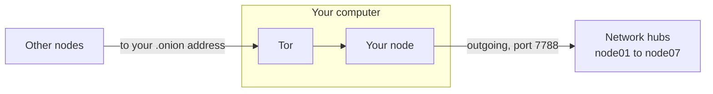

# Make your node reachable over Tor

This is **step 5** of [Become a miner](become-a-miner.md), and it is optional.
Skip it and your node still syncs, mines, and earns — nothing here is required.
You can come back and do it later without changing anything else about your setup.

## What this gets you, and what it does not

Your node dials out to the network's hubs and keeps up with the chain that way.
What it cannot do, on an ordinary home connection, is accept a connection coming
*in*: your router gives your machine a private address, so there is nothing for
another node to dial. Without Tor, a home miner can reach other nodes but cannot
be reached by them.

Publishing a Tor v3 onion service gives your node an address other nodes can
dial. You do not have to forward a port on your router, pay for a static IP, or
expose your home IP address. Once you set it in your config (step 4), your node
announces the address to its peers and they pass it on, so other nodes find you
and connect on their own.



Be clear on the limits:

- **It does not hide the chain.** Blocks and transactions are public by design.
  There is nothing in them to conceal.
- **Your node's identity is already post-quantum, with or without Tor.** Peers
  prove who they are with ML-DSA certificates and agree session keys with
  ML-KEM-768, so the link between two nodes is post-quantum either way. Tor's own
  encryption is classical. What Tor adds here is an inbound route and privacy
  about where your node is — not confidentiality of what it sends.

## 1. Install Tor

On Debian, Ubuntu, or WSL:

```
sudo apt install tor
```

On macOS, with [Homebrew](https://brew.sh):

```
brew install tor
```

The SOCKS5 proxy your node dials out through runs on `127.0.0.1:9050` by
default, which is exactly where your node already looks for it. There is nothing
to configure for outbound connections.

## 2. Publish an onion service

Find your node's `listen_port` in `~/7fchain/testnet/l1/node-config.json`
(`7788` unless you changed it). Then add the lines below to Tor's configuration
file, using that same port in both places on the last line.

On Debian, Ubuntu, or WSL, edit `/etc/tor/torrc`:

```
HiddenServiceDir /var/lib/tor/7fchain/
HiddenServiceVersion 3
HiddenServicePort <listen_port> 127.0.0.1:<listen_port>
```

On macOS, the file is `$(brew --prefix)/etc/tor/torrc` and the service folder
lives under your Homebrew prefix. These lines create the folder and add the
three settings (change both `7788`s if your `listen_port` is different):

```
mkdir -p "$(brew --prefix)/var/lib/tor"
echo "HiddenServiceDir $(brew --prefix)/var/lib/tor/7fchain/" >> "$(brew --prefix)/etc/tor/torrc"
echo "HiddenServiceVersion 3" >> "$(brew --prefix)/etc/tor/torrc"
echo "HiddenServicePort 7788 127.0.0.1:7788" >> "$(brew --prefix)/etc/tor/torrc"
```

## 3. Restart Tor and read your address

On Debian, Ubuntu, or WSL:

```
sudo systemctl restart tor
sudo cat /var/lib/tor/7fchain/hostname
```

On WSL without systemd, use `sudo service tor restart` for the first line.

On macOS:

```
brew services restart tor
cat "$(brew --prefix)/var/lib/tor/7fchain/hostname"
```

That prints a 56-character address ending in `.onion`. Tor generated the key
itself and keeps it in that folder; back the folder up if you want to keep the
same address after rebuilding the machine.

## 4. Announce your address

In `~/7fchain/testnet/l1/node-config.json`, set `advertised_onion` to your
address followed by your `listen_port`:

```
"advertised_onion": "<your-56-char-address>.onion:<listen_port>"
```

Then restart your node (stop it and start it again, as in
[Run your node](run-your-node.md)). From then on, every peer your node connects
to is told your address, passes it on to its own peers, and keeps it in its
address book. Your node re-announces it regularly so it stays fresh, and other
nodes dial you over Tor without anyone configuring anything.

If you leave `advertised_onion` unset, your node still peers normally and still
accepts inbound onion connections from anyone you give the address to. It just
is not announced.

## 5. Peer with someone directly (optional)

Announcing is enough for the network to find you. If you also want a particular
node to connect to yours straight away, send your `.onion` address and port to
its operator over any channel you trust. From their node home they run:

```
sf-node peers add <your-56-char-address>.onion:<listen_port>
```

and restart their node. `sf-node peers` lists the peers added this way, and
`sf-node peers remove <host:port>` takes one off.

You never need to add the network's hubs yourself: your node always knows them
and dials them on startup, whatever your `seed_peers` list holds.

Carry on with [Become a miner](become-a-miner.md).

---

Back to [Become a miner](become-a-miner.md) · [Run your node](run-your-node.md)
