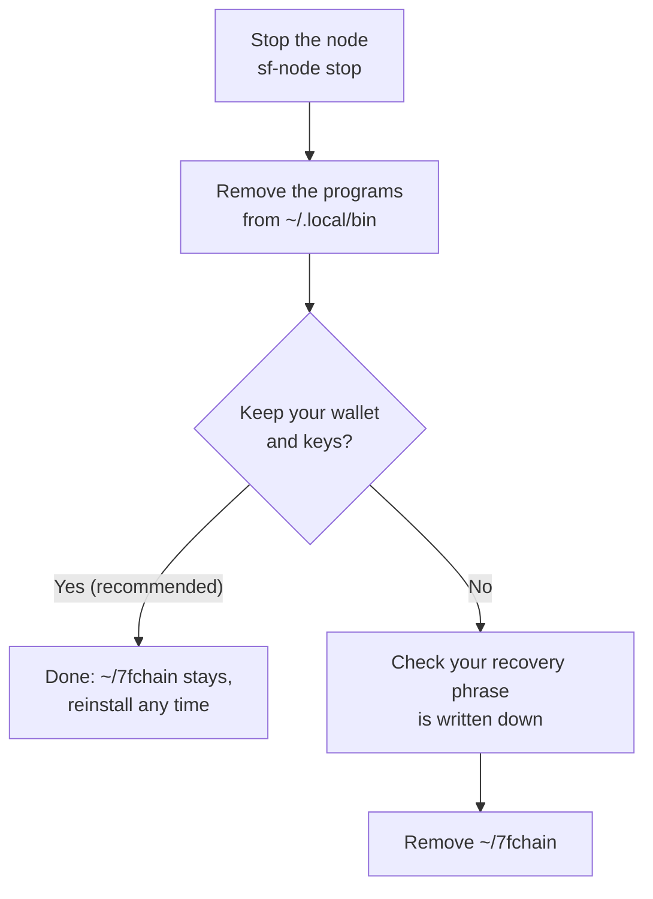

# Uninstall 7fchain

How to remove the 7fchain programs, and, only once you're sure, your node's data.



## 1. Stop the node

```
sf-node stop
```

If you ran it in tmux, close that session too: `tmux kill-session -t 7fchain`.

## 2. Remove the programs

```
rm ~/.local/bin/sf-node ~/.local/bin/sf-wallet ~/.local/bin/sf-explorer
```

You can also delete the downloaded releases with `rm -r ~/7fchain-releases`, if you used that folder.

If `~/.local/bin` wasn't already on your `PATH`, `setup.sh` added these two lines to the end of `~/.bashrc` (on macOS too):

```
# Added by 7fchain setup.sh
export PATH="$HOME/.local/bin:$PATH"
```

Leave them if other programs use `~/.local/bin`; otherwise delete them in a text editor. On macOS, also delete the `PATH` line you added to `~/.zshrc`.

## 3. Remove Tor's settings (if you set up Tor)

Delete the three `HiddenService…` lines you added to `torrc` (`/etc/tor/torrc` on Linux, `$(brew --prefix)/etc/tor/torrc` on macOS), restart Tor, and delete the onion service folder (`/var/lib/tor/7fchain/`, or `$(brew --prefix)/var/lib/tor/7fchain/` on macOS). On Linux these need `sudo`: `sudo nano /etc/tor/torrc`, `sudo systemctl restart tor` and `sudo rm -r /var/lib/tor/7fchain/`. Uninstall Tor itself if nothing else uses it.

## 4. Your wallet and keys

**`~/7fchain` holds your wallet, your keys and your certificates.** Removing the programs leaves it in place, so you can reinstall later and carry on.

Delete it only if all of these are true:

- your 24-word recovery phrase is written down and you can read it;
- you've moved any coins you want to keep;
- you don't need the identities or certificates in it any more.

Then:

```
rm -r ~/7fchain
```

Your recovery phrase restores your wallet and miner identities: `sf-wallet init --import`, then `sf-wallet miner-export` and `sf-node import` as in [step 2](create-wallet-and-request.md). Certificates aren't in it: you'd get new ones with `sf-node obtain`, which uses your API key's allowance.

---

Back to [Docs](README.md)
