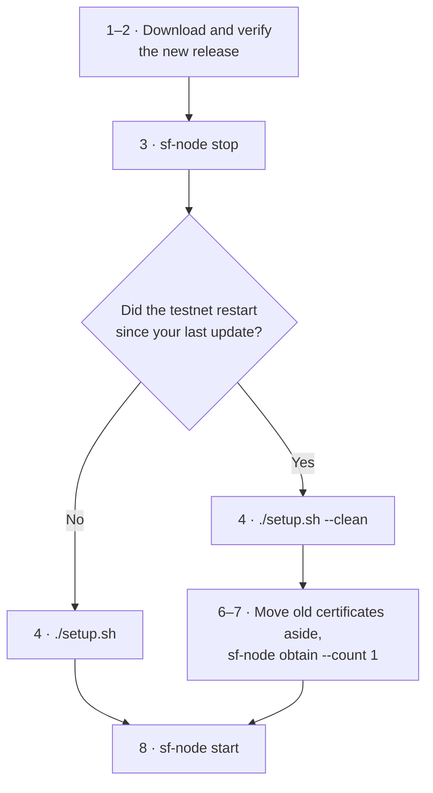

# Update Your Miner

For miners who already run a 7fchain node and want the new release. New miners: follow [Become a miner](become-a-miner.md) instead.

> **The current release is `testnet-2026-10-22`, and every miner needs it:** earlier releases stop syncing at block 496. The testnet did not restart, so your chain, wallet, keys and certificates all carry over. Follow steps 1–5, 8 and 9.
>
> If you last updated before `testnet-2026-10-16.2`, the testnet has restarted since: use `./setup.sh --clean` in step 4 and do steps 6 and 7 as well.

All commands run on your node machine. Your node home is `~/7fchain/testnet/l1`.



## 1. Download the new release

Pick your platform (`uname -sm` tells you which):

| `uname -sm` prints | Platform |
|---|---|
| `Linux x86_64` | `x86_64-linux` |
| `Linux aarch64` | `aarch64-linux` |

On a Mac, see [7fchain on macOS](macos.md).

Download the archive and the checksum file into a new folder (set `PLATFORM` to yours):

```
REL=testnet-2026-10-22
PLATFORM=x86_64-linux
mkdir -p ~/7fchain-releases/$REL && cd ~/7fchain-releases/$REL
curl -fLO https://github.com/Seven-Fortunas/7fchain/releases/download/$REL/7fchain-$REL-$PLATFORM.tar.gz
curl -fLO https://github.com/Seven-Fortunas/7fchain/releases/download/$REL/SHA256SUMS
```

You can also download both files from the [Releases page](https://github.com/Seven-Fortunas/7fchain/releases/latest) in your browser.

## 2. Verify it

```
grep $PLATFORM.tar.gz SHA256SUMS | sha256sum -c
```

You should see your archive's name followed by **`OK`**. If it says `FAILED`, do not run it: delete it and download again. More detail: [Verify your download](verify-your-download.md).

## 3. Stop your node

```
sf-node stop ~/7fchain/testnet/l1/node-config.json
```

It prints `sf-node stopped cleanly.` If the node wasn't running, it says so; carry on.

## 4. Run the new setup

```
tar xzf 7fchain-$REL-$PLATFORM.tar.gz
cd 7fchain-$REL-$PLATFORM
./setup.sh
```

Plain `./setup.sh` replaces the programs and keeps everything else, chain included. If it stops with `Text file busy`, your node is still running: do step 3 again, then rerun `./setup.sh`.

Use `./setup.sh --clean` instead only when the testnet has restarted since your last update (the last restart was `testnet-2026-10-16.2`). It also clears the chain database and peer list and refreshes the network files, so your node downloads the new chain. It **keeps** your wallet, keys, `miner-0/`, `node-config.json` and the registrar certificate in `certs/`.

## 5. Check the version

```
sf-node --version
```

For `testnet-2026-10-22` it prints `sf-node 0.2.930 (19237f1)`.

## 6. Move your old certificates aside (after a restart only)

Certificates from before a restart no longer work, and a node that finds one refuses to start. Move them out of `miner-0/`:

```
cd ~/7fchain/testnet/l1
mkdir -p ~/7fchain/old-certs
mv miner-*/miner-cert-*.pem ~/7fchain/old-certs/
```

This moves certificate files only. Your keys stay where they are.

## 7. Get new certificates (after a restart only)

After a restart your API key's allowance is reset. In the same terminal, load your key (nothing is shown as you type) and get a certificate:

```
cd ~/7fchain/testnet/l1
printf 'API key: '; read -rs SF_OBTAIN_KEY; echo; export SF_OBTAIN_KEY
sf-node obtain --count 1
```

At `Enter ML-DSA keyfile password:`, type your boot password. You should see `installed miner-0/ ...` and then `session chain already at .../session-chain.pem`: your node keeps the session certificate it already has. When you're done, run `unset SF_OBTAIN_KEY`. Details and error messages: [Get a testnet certificate](get-a-testnet-certificate.md).

## 8. Start your node

```
sf-node start ~/7fchain/testnet/l1/node-config.json
```

Type your boot password. The node reloads its chain (`Chain reloaded. Height: …`) and syncs on from there, printing a line for each block, such as `[dispatch] accepted block 497 from 203.0.113.10:7788`. When it reaches the network's tip it prints `[trusted-tip] OK: local chain == consensus tip` and starts mining. Compare its height with the network's at [explore.sevenfortunas.com](https://explore.sevenfortunas.com/).

## 9. Check your certificates

In a second terminal, while the node runs:

```
sf-node certs ~/7fchain/testnet/l1/node-config.json
```

Your certificates are listed with their serials, block caps (`? of 50`) and expiry. The `?` is normal while the node is running: it can't read its block store then, so it can't count blocks left. To see the count, stop the node, run the command again, and start the node again.

Your blocks show on the [Miners page](https://explore.sevenfortunas.com/miners) under your payout address, with `Cert remaining` counting down.

More on running, stopping and restarting: [Run your node](run-your-node.md).

---

**Never delete `~/7fchain` to "start fresh".** It holds your wallet and keys. `./setup.sh --clean` is the safe way to start the chain over.
